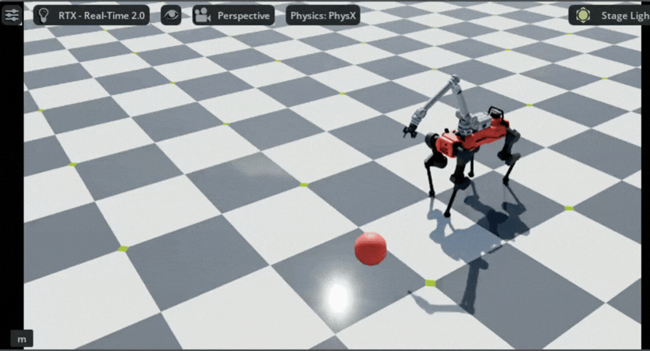
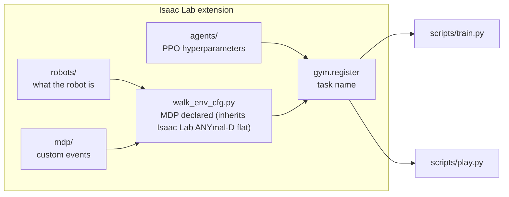
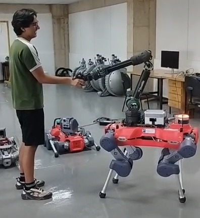

# Locomotion policy for a legged manipulator (ANYmal D + DynaArm + Robotiq 2F-85)

**Problem.** Train a velocity-tracking walking policy for an ANYmal D that carries a DynaArm and a gripper, so the extra mass and geometry are part of the training. The policy moves only the 12 leg joints; the arm and gripper are held at a fixed pose by their PD controllers.

Isaac Lab 3.0 / Isaac Sim 6.1, PhysX. PPO (RSL-RL), 2048 parallel environments, 1500 iterations, started from a policy trained on the bare robot. Legs are driven through the ANYdrive actuator network.

## MDP

| | Details |
|---|---|
| Observations (48) | base linear velocity (3), base angular velocity (3), projected gravity (3), velocity command (3), leg joint positions (12), leg joint velocities (12), last action (12) |
| Actions (12) | leg joint position targets (offset from default pose) |
| Rewards | linear-velocity tracking (+1.0), yaw-rate tracking (+0.5), vertical velocity (-2.0), roll/pitch rate (-0.05), joint torques (-2.5e-5), joint acceleration (-2.5e-7), action rate (-0.01), feet air time (+0.5), undesired contacts (-1.0), flat orientation (-5.0) |
| Terminations | time out, illegal base contact |
| Domain randomization | foot friction, base mass (+-5 kg), random pushes, observation noise, random initial state |

## Architecture

Entry scripts are thin: they only ask for the task by its registered name. Robot, MDP functions and PPO settings each live in their own file.

## The robot

*Me with the ANYmal D at the USP Center for Robotics (CROB).*

## Results

- Linear-velocity tracking reward reached 0.90 (maximum 1.0) after 1500 iterations (training log).
- Video: robot walking toward a target with the arm on board (see above).

> *Code is confidential (USP Center for Robotics - CROB) and cannot be shared. Available upon request with lab approval.*
